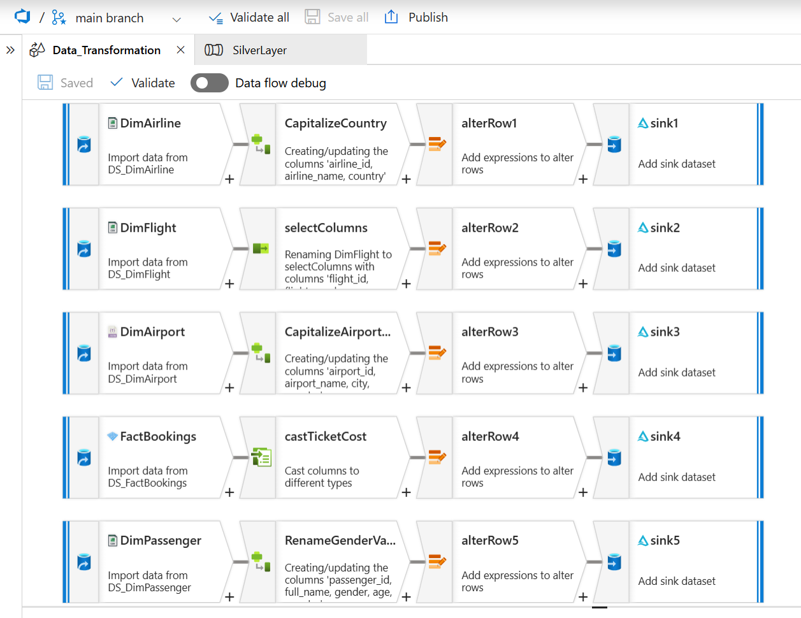
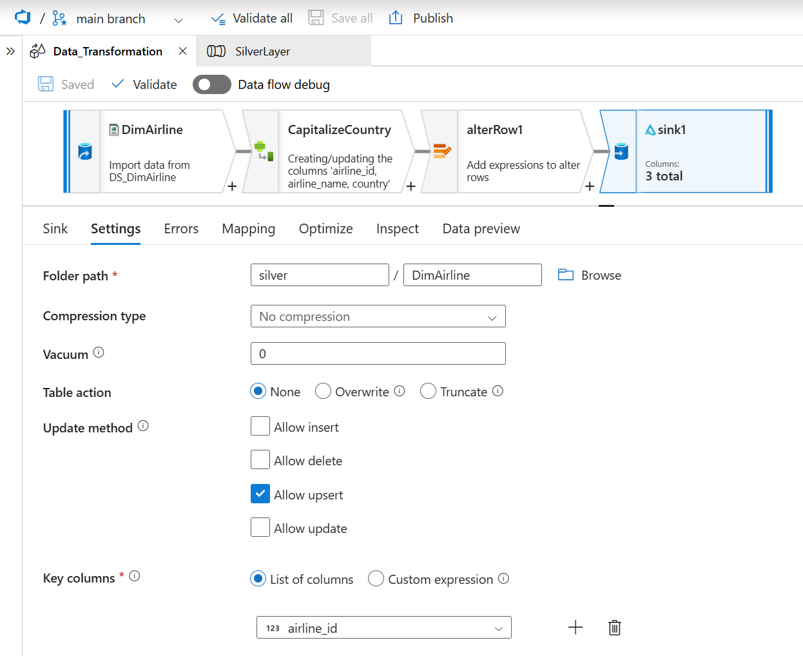
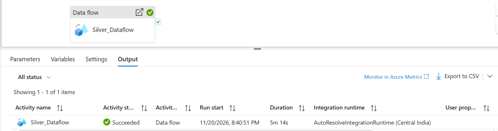
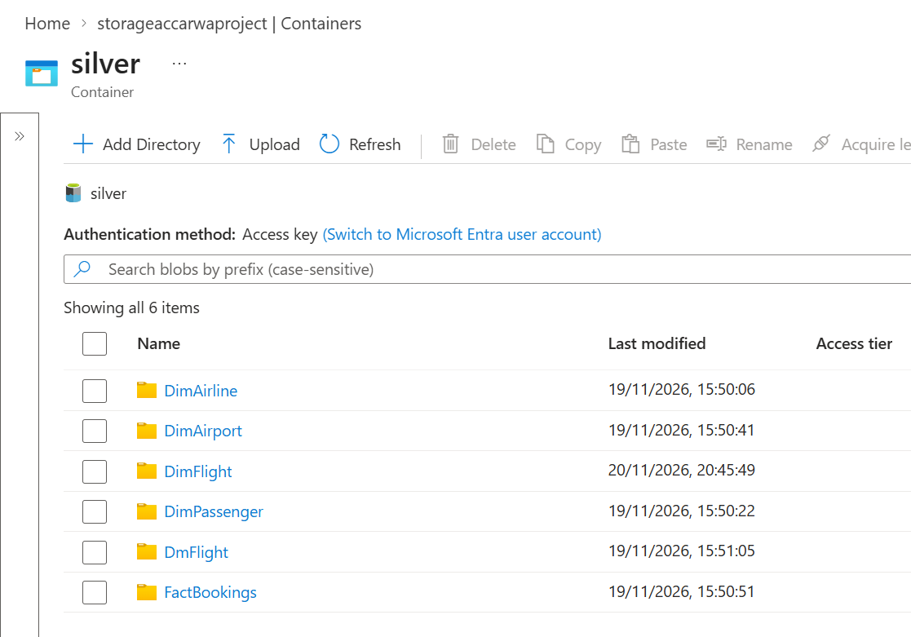

# ADF Silver Layer: Mapping Data Flow to Delta Lake

An Azure Data Factory (ADF) project that cleans five tables from the **bronze** container with a **Mapping Data Flow** and writes them to the **silver** container in **Delta** format. Each table gets its own small transformation, and every sink uses **upsert**, so re-running the pipeline updates existing rows instead of duplicating them.



## What it does

```
bronze (5 source tables)
        │
        ▼
 Data flow: Data Transformation
   ├─ DimAirline   → uppercase country        → upsert → silver/DimAirline
   ├─ DimFlight    → rename column            → upsert → silver/DimFlight
   ├─ DimAirport   → uppercase airport name   → upsert → silver/DimAirport
   ├─ FactBookings → cast ticket_cost         → upsert → silver/FactBookings
   └─ DimPassenger → M/F → Male/Female        → upsert → silver/DimPassenger
```

The pipeline `SilverLayer` has one activity, **Execute Data Flow** (`Silver_Dataflow`), which runs the data flow `Data Transformation`.

## Transformations per table

| Table | Transformation | Result | Upsert key |
|---|---|---|---|
| `DimAirline` | `CapitalizeCountry` (Derived column) | `country` converted to uppercase | `airline_id` |
| `DimFlight` | `selectColumns` (Select) | `departure_time` renamed to `departure_timestamp` | `flight_id` |
| `DimAirport` | `CapitalizeAirportName` (Derived column) | `airport_name` converted to uppercase | `airport_id` |
| `FactBookings` | `castTicketCost` (Cast) | `ticket_cost` cast from decimal to integer | `booking_id` |
| `DimPassenger` | `RenameGenderValues` (Derived column) | `M` becomes `Male`, `F` becomes `Female`, other values unchanged | `passenger_id` |

Each table then passes through an **Alter row** step set to upsert and into a **Delta** sink.

### Source columns

| Table | Columns |
|---|---|
| `DimAirline` | airline_id, airline_name, country |
| `DimFlight` | flight_id, flight_number, departure_time, arrival_time |
| `DimAirport` | airport_id, airport_name, city, country |
| `FactBookings` (Parquet) | booking_id, passenger_id, flight_id, airline_id, origin_airport_id, destination_airport_id, booking_date, ticket_cost, flight_duration_mins, checking_status |
| `DimPassenger` | passenger_id, full_name, gender, age, country |

## Sink settings (all five sinks)

| Setting | Value |
|---|---|
| Format | Delta |
| Container | `silver` |
| Write behavior | Upsert only (insert, update and delete are off) |
| Key columns | One per table (see above) |
| Linked service | `LS_datalake` (Azure Data Lake Storage Gen2) |

**Upsert** means: if a row with the same key already exists, update it. If not, insert it. That's why the pipeline can run again without creating duplicates.



## Components

| Component | Details |
|---|---|
| Pipeline | `SilverLayer` |
| Activity | `Silver_Dataflow` (Execute Data Flow) |
| Data flow | `Data Transformation` (5 sources, 5 sinks) |
| Datasets | `DS_DimAirline`, `DS_DimFlight`, `DS_DimAirport`, `DS_FactBookings`, `DS_DimPassenger` |
| Compute | General purpose, 8 cores |
| Destination | Azure Data Lake Storage Gen2, `silver` container, Delta format |

## How to recreate it

1. Have your raw (bronze) files in the data lake, plus a linked service and one dataset per table.
2. Create a **Mapping Data Flow**. Add the five sources, one per dataset.
3. Add the transformation for each table (see the table above).
4. After each one, add an **Alter row** transformation with an **Upsert if** condition that is always true.
5. Add a **Sink** for each table: dataset type Delta, container `silver`, a folder per table, **Allow upsert** on, and the key column(s).
6. Create a pipeline and add an **Execute Data Flow** activity that runs the data flow.
7. **Publish all**, then **Debug** the pipeline and check the **Output** tab.

> Data flows run on a Spark cluster, so a run takes longer than a Copy activity. Turn off **Data flow debug** when you're done so the debug cluster doesn't keep running.

## Result

After a successful run, the `silver` container contains one Delta folder per table, each with its data files and a `_delta_log` folder.




## Project files

```
pipeline/
└── SilverLayer.json
dataflow/
└── Data_Transformation.json
images/
```

JSON was exported from ADF Studio using the **{ }** code view. Linked services are intentionally not included because they can contain credentials.
